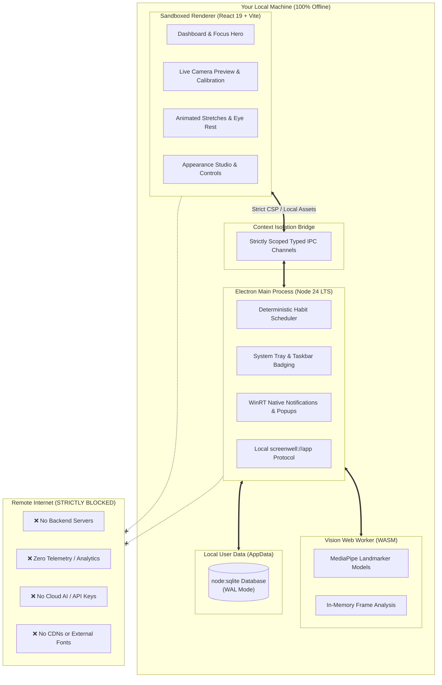

<div align="center">


# ScreenWell

### **Rest your eyes. Reset your posture. Reclaim your focus.**

*An ultra-private, 100% offline desktop companion engineered for healthy digital study and work habits.*  
*Created for the **Applied Design Thinking Lab (CS238DL)** · Supporting **UN SDG 3: Good Health and Well-Being**.*

[](https://github.com/Tech-Adii/ScreenWell/releases/tag/v1.14.0)
[](https://github.com/Tech-Adii/ScreenWell/releases)
[](#-radical-privacy--offline-first-architecture)
[](LICENSE)
[](VALIDATION.md)
[](#-smart-on-device-vision-engine)

[🚀 Download ScreenWell 1.14.0 Setup](https://github.com/Tech-Adii/ScreenWell/releases/tag/v1.14.0) • [✨ Key Features](#-core-capabilities) • [🏗️ Architecture](#-system-architecture) • [📖 Quick Start](#-quick-start--installation) • [🔬 Validation Suite](VALIDATION.md)

</div>

---

## 🌟 Executive Summary

In today's academic and high-output technical environments, students and knowledge workers spend 4 to 10+ uninterrupted hours in front of screens. The resulting toll—**Computer Vision Syndrome (CVS), postural kyphosis ("tech neck"), chronic dehydration, and cognitive fatigue**—severely impacts health and learning efficiency.

Existing reminder and productivity utilities often demand online accounts, harvest invasive telemetry, rely on brittle cloud backends, or lock user screens with aggressive popups that disrupt critical exams and deadlines.

**ScreenWell** is built differently. It is an **offline-first, zero-telemetry, non-punitive desktop companion** that combines:
1. **On-Device Computer Vision (MediaPipe WASM)**: Runs local blink-rate (EAR), 3D neck/shoulder skeletal posture tracking, and relative screen proximity estimation entirely in volatile RAM.
2. **Deterministic Focus & Study Scheduler**: Features guided study blocks (Quick Review, Balanced Study, Practice Exam), live Windows taskbar badge countdowns, and non-blocking `showInactive()` desktop nudges.
3. **Ergonomic Coaching & Guided Routines**: Provides 6-step animated eye routines (20-20-20 rule), 16 illustrated desk stretches (Mayo Clinic aligned), and offline voice coaching using native OS voices.
4. **Radical Privacy by Design**: Zero accounts, zero server dependencies, zero telemetry, and an isolated "Mentor Demo Mode" for safe demonstration and grading.

> [!IMPORTANT]
> **Health & Medical Scope:** ScreenWell is a calibrated ergonomic habit companion designed to prompt mindful comfort breaks; it is **not a clinical diagnostic tool or medical device**. Posture and blink thresholds are transparent personal heuristics.

---

## 📊 Human-Centered Design Traceability ($N = 91$)

ScreenWell was developed following the rigorous **Design Thinking Framework** (Empathize $\rightarrow$ Define $\rightarrow$ Ideate $\rightarrow$ Prototype $\rightarrow$ Test) in the **Applied Design Thinking Lab (CS238DL)**. Its features stem directly from empirical survey findings from **91 student and knowledge-worker respondents**:

| Survey Finding ($N = 91$) | Human-Centered Design Response | Technical Implementation |
| :--- | :--- | :--- |
| **52.7%** use laptops/PCs **4+ hours/day** | Sustainable, personalized pacing | Main-process deterministic scheduler with customizable work/rest cycles |
| **60.4%** report **tired or dry eyes** | Active blink awareness & eye rest | Local MediaPipe EAR tracking (12 blinks/min heuristic) + animated 20-20-20 guides |
| **47.0%** experience **neck & shoulder strain** | Real-time posture & ergonomics cues | 3D skeletal neck/shoulder angle tracking with sustained hold detection (score < 80) |
| **70.3%** skip breaks due to focus & deadlines | Non-disruptive, graceful deferral | **Important Task Mode** (exam shield), smart snooze (5/10/15m), and typing pauses |
| **73.6%** demand **snooze & pause controls** | Absolute user autonomy (no locked screens) | Topmost `showInactive()` popups with snooze, skip, and off-for-today actions |
| **39.6%** prefer non-modal desktop popups | Subtitle-style desktop notifications | Independent floating desktop reminder card alongside native WinRT toast alerts |
| **45.1%** want **hydration tracking** | Frictionless habit reinforcement | Animated water glass logger, customizable daily goal, active hours, and streaks |
| **38.5%** seek **guided desk stretches** | Actionable physical resets | 16 illustrated upper-body & wrist stretches with seated accessibility options |
| **39.6%** express **privacy reluctance with webcams** | Privacy-first architecture | **100% Offline**: camera off by default; explicit session consent; RAM-only processing |
| **30.8%** request **progress summaries** | Guilt-free reflection & reporting | Local habit score formula, daily/weekly charts, and deterministic PDF/CSV exports |

---

## ✨ Core Capabilities

### 👁️ Smart On-Device Vision Engine
ScreenWell leverages Google’s **MediaPipe Tasks Vision** bundled locally as WASM runtimes and offline models—executing strictly within dedicated Web Workers:
* **Blink Rate Monitoring (EAR)**: Computes Eye Aspect Ratio with temporal smoothing and gap-rejection algorithms to accurately track blink frequency without false positives from squinting.
* **3D Posture & Spine Alignment**: Tracks shoulder slope, neck length, and head tilt angles using MediaPipe Pose Landmarker (selectable **Lite**, **Full**, or **Heavy** models operating at 5–8 FPS to preserve battery life).
* **Relative Proximity Warnings**: Detects prolonged forward-head slouching (triggers after 10 continuous seconds at 125% calibrated face-scale) with a 60-second recovery cooldown.
* **Transparent Signal Confidence**: Computes an honest real-time confidence rating derived from lighting conditions, head angle, and landmark visibility. If the user steps away or lighting degrades, it gracefully displays status without guessing.

```text
       [Webcam Frame]
             │
             ▼ (Volatile in-memory transfer)
   [Vision Web Worker] ──► MediaPipe Face & Pose WASM (5-8 FPS)
             │
             ├──► Eye Aspect Ratio (EAR) ──► Blink Rate Analysis
             ├──► 3D Skeletal Angles     ──► Posture Score (Threshold: 80)
             └──► Face Scale Ratio       ──► Proximity / Distance Warning
             │
             ▼
   [Immediate Memory Drop] (Zero frames saved, Zero network requests)
```

### ⏱️ Guided Study Sessions & Deep Focus Planner
* **Pre-Configured Study Profiles**: Choose from **Quick Review** (short study bursts), **Balanced Study** (classic Pomodoro cadence), or **Practice Exam** (extended focus blocks). Save up to 8 custom profiles.
* **Taskbar Countdown & Notification Tooltip**: On Windows, minimizing the application updates the taskbar icon with a live countdown badge and progress bar, keeping you informed at a glance.
* **Automatic Absence & Step-Away Logging**: If camera monitoring is active and you leave your desk, ScreenWell tracks the sustained absence and prompts you upon return: *"Count as break"* or *"Dismiss"*.
* **Important Task Mode**: Silence all notifications and timers instantly during presentations, live coding sessions, or examinations.

### 🧘 Interactive Guided Exercises & Voice Coaching
* **6-Step Animated Eye Rest**: Guides you through distance gaze, soft blinking, closed-eye resting, gentle palming, near/far focus shifts, and figure-eight tracking.
* **16 Illustrated Desk Stretches**: Targeted physical routines for neck, shoulders, chest, forearms, and wrists based on Mayo Clinic desk ergonomics.
* **Offline Voice Guidance**: Optional soothing voice narration powered solely by local, installed Windows/OS speech synthesizers. No remote voice APIs, no microphones, no internet required.

### 💧 Hydration Companion & Daily Productivity
* **Hydration Tracker**: Set custom daily fluid goals and active hours. Log glasses with a single click and maintain healthy hydration streaks.
* **Daily Top 5 Priorities**: Organize today’s most critical objectives and set an explicit daily focus goal that persists across app restarts.
* **1–2 Minute Breathing Reset**: Take an on-demand mental reset with an animated expanding/contracting breathing circle, complete with reduced-motion support.
* **Command Palette (`Ctrl + K`)**: Instantly search pages, trigger quick actions, or toggle focus timers with keyboard-driven speed.

### 🎨 Appearance Studio & Universal Accessibility
* **9 Curated Color Palettes**: Pick between Forest, Ocean, Amber, Midnight, Plum, Slate, and more—or customize your own primary and companion colors with automated contrast validation.
* **Motion Intensity Levels**: Toggle between **Still**, **Gentle**, or **Expressive** motion styles. ScreenWell strictly honors Windows and OS `prefers-reduced-motion` settings.
* **High-Contrast & Large Fonts**: Fully readable at up to 130% zoom in both light and dark modes with comprehensive ARIA labels and focus trapping.

### 📊 Local Analytics, Export & Mentor Demo
* **Transparent Habit Score**: Calculated objectively without proprietary black boxes:
  $$\text{Habit Score} = \text{Breaks Completed}(40\%) + \text{Hydration Target}(30\%) + \text{Observed Posture}(20\%) + \text{Blink Rhythm}(10\%)$$
* **Deterministic Client-Side PDF & CSV Export**: Generate clean, professional audit reports using embedded `@pdf-lib` and local fonts—guaranteeing formula injection safety in exported CSVs.
* **Mentor Demo Mode**: Switch to an isolated, in-memory synthetic dataset with pre-seeded study sessions, hydration logs, and posture check-ins for classroom presentations and evaluations without touching personal records.

---

## 🔒 Radical Privacy & Offline-First Architecture

ScreenWell was designed with a zero-trust model toward third-party surveillance:



### Security & Privacy Guarantees
1. **Zero External Network Connections**: Content Security Policy (CSP) forbids external scripts, styles, fonts, and network endpoints. The application is served strictly via the local `screenwell://app` protocol.
2. **Volatile Frame Processing**: Camera video feeds are transferred directly to worker memory, processed for landmark coordinates, and immediately dereferenced. **No frames, images, or audio are ever written to disk or transmitted.**
3. **Opt-In Camera Permissions**: The camera is strictly **OFF** on initial startup and every subsequent launch. Camera use is decoupled from study sessions and can be revoked at any moment with a single click.
4. **Built-In SQLite Storage**: Leverages Node's native `node:sqlite` within Electron 45, avoiding external binary compilation issues and keeping user logs localized to `%APPDATA%\ScreenWell\screenwell.sqlite`.

---

## 📂 Repository Layout

```text
ScreenWell/
├── main/               # Electron lifecycle, window management, system tray, WinRT notifications, IPC
├── renderer/           # React 19 UI, Lucide icons, Recharts, exercise animations, Appearance Studio
├── engine/             # Pure deterministic scheduler for breaks, hydration, stretches, and quiet hours
├── vision/             # Pure MediaPipe vision workers, EAR calculations, 3D posture heuristics
├── data/               # Native node:sqlite migrations, summary aggregators, PDF-Lib generators
├── shared/             # Type-safe IPC contracts, default configurations, and Zod schemas
├── assets/             # Bundled MediaPipe models, WASM binaries, Nunito Sans fonts, app icons, chimes
├── scripts/            # Asset prepackagers, licenses auditor, offline verification, and setup builders
├── tests/              # Vitest unit test suite (118 tests) & Playwright desktop UI scenarios (22 tests)
├── release/            # NSIS installer scripts, portable builds, and verification hashes
├── DECISIONS.md        # 23 architectural decision records (ADRs) with rationale
├── PRIVACY.md          # Comprehensive data storage and memory lifecycle disclosures
├── TRACEABILITY.md     # Full mapping of N=91 survey findings to implemented code
├── VALIDATION.md       # Empirical testing records, test coverage, and release checks
└── WELLNESS-GUIDANCE.md# Medical disclaimer, Mayo Clinic stretch sources, and AAO references
```

---

## 🚀 Quick Start & Installation

### Option 1: Windows x64 Installer (Recommended)
1. Download **[ScreenWell 1.14.0 Setup](https://github.com/Tech-Adii/ScreenWell/releases/tag/v1.14.0)** (`ScreenWell-1.14.0-Setup.exe`).
2. Run the installer. It installs locally for your Windows user profile without requiring administrator privileges.
3. Launch ScreenWell from your desktop shortcut or Start Menu.

> [!NOTE]
> **Windows Smart App Control Notice:** Because this is an academic open-source build without a paid EV certificate from Microsoft's Trusted Root Program, Windows Defender or Smart App Control may display an unrecognized publisher prompt. You can review the exact SHA-256 integrity hash in [VALIDATION.md](VALIDATION.md) and verify the source code.

### Option 2: Portable Executable
Prefer not to install? Download `ScreenWell-1.14.0-Portable.exe` from the [Releases](https://github.com/Tech-Adii/ScreenWell/releases) page and run it directly from any folder or USB drive.

### Option 3: macOS (Apple Silicon & Intel)
ScreenWell source code contains full macOS support (DMG and ZIP packaging targets). To build on macOS:
```bash
git clone https://github.com/Tech-Adii/ScreenWell.git
cd ScreenWell
chmod +x Build-on-Mac.command
./Build-on-Mac.command
```
*(Or refer to [MAC-README.md](MAC-README.md) for step-by-step Apple Silicon/Intel build details).*

---

## 🛠️ Developer Guide & Toolchain

### Prerequisites
* **Operating System**: Windows 10/11 x64 or macOS (12+)
* **Runtime**: [Node.js 24 LTS](https://nodejs.org/) or newer with `npm`
* **Compilers**: NSIS 3.12+ (for building Windows setup packages) and 7-Zip

### Initial Setup & Development
```powershell
# Clone the repository
git clone https://github.com/Tech-Adii/ScreenWell.git
cd ScreenWell

# Install pinned dependencies
npm ci

# Download and verify offline MediaPipe models, WASM runtimes, and local assets
npm run assets

# Start application in development mode (with hot reloading and type checking)
npm run dev
```

### Verification & Testing Suite
ScreenWell enforces strict static analysis, unit testing, and desktop automation before any release:

```powershell
# Run the 118 unit tests (scheduler, vision geometry, SQLite storage, score formula)
npm test

# Run code style & static analysis
npm run lint

# Run Playwright desktop end-to-end scenarios (launches real Electron window)
npm run test:ui
```

### Production Packaging
```powershell
# Build standard NSIS Windows setup installer + verify with 7-Zip
npm run dist:setup

# Build portable single-file executable
npm run dist:portable

# Build all distribution targets
npm run dist
```

To create a signed release with an official Authenticode certificate:
```powershell
$env:SCREENWELL_SIGN_CERT_SHA1 = "<Certificate-Thumbprint>"
$env:SCREENWELL_SIGNTOOL = "C:\Program Files (x86)\Windows Kits\10\bin\10.0.22621.0\x64\signtool.exe"
$env:SCREENWELL_MAKENSIS = "C:\Program Files (x86)\NSIS\makensis.exe"
npm run dist:setup:signed
```

---

## 🔬 Validation & Reliability Record

Release **v1.14.0** has been systematically audited:
* ✅ **118 Vitest Unit Tests**: Validates deterministic scheduling, EAR transitions, posture geometry smoothing, streak counters, SQLite schema integrity, CSV formula neutralization, and PDF generation.
* ✅ **22 Playwright Desktop Scenarios**: Tests onboarding workflows, guided study blocks, taskbar timer integration, offline voice routing, popup dismissals, quiet hours, and memory drop after camera deactivation.
* ✅ **Zero Remote Leakage**: Automated scanner confirms zero runtime HTTP/HTTPS requests or external CDN dependencies.
* ✅ **Integrity Verification**: 100% file match between packaged NSIS archive and unpacked runtime binaries.

Full audit logs, SHA-256 checksums, and regression notes are maintained in [VALIDATION.md](VALIDATION.md).

---

## 📚 Project Documentation Hub

Explore the complete engineering and research documentation:
* 📑 **[DECISIONS.md](DECISIONS.md)**: 23 Architectural Decision Records (ADRs) explaining tech stack, SQLite selection, offline vision heuristics, and non-blocking notification philosophy.
* 🛡️ **[PRIVACY.md](PRIVACY.md)**: Exhaustive data dictionary, local storage lifecycle, and memory management disclosures.
* 📈 **[TRACEABILITY.md](TRACEABILITY.md)**: Comprehensive mapping between the $N = 91$ student survey findings and concrete feature implementations.
* 🩺 **[WELLNESS-GUIDANCE.md](WELLNESS-GUIDANCE.md)**: Clinical scope, American Academy of Ophthalmology (AAO) computer vision references, and Mayo Clinic desk stretch guidelines.
* 🎭 **[DEMO_SCRIPT.md](DEMO_SCRIPT.md)**: Complete step-by-step walkthrough script for mentors, reviewers, and evaluators.
* 🍎 **[MAC-README.md](MAC-README.md)**: Dedicated compilation instructions for macOS Monterey, Ventura, Sonoma, and Sequoia.
* 📜 **[CHANGELOG.md](CHANGELOG.md)**: Complete release history detailing features from v1.0.0 through v1.14.0.

---

## 🎓 Academic Alignment & SDG 3

ScreenWell was developed as an academic project within the **Applied Design Thinking Lab (CS238DL)**, directly addressing **United Nations Sustainable Development Goal 3**:
> **UN SDG 3: Good Health and Well-Being** — *Ensure healthy lives and promote well-being for all at all ages.*  
> Specifically targeting **Target 3.4**: Promoting mental health, well-being, and preventive physical health habits in high-stress digital study environments.

---

## 📄 License & Attribution

ScreenWell is open-source software licensed under the **[MIT License](LICENSE)**.

Developed with ❤️ by **[Tech-Adii](https://github.com/Tech-Adii)** and the ScreenWell team for CS238DL.  
*All third-party open-source components, models, and font licenses are documented in [THIRD_PARTY_NOTICES.md](THIRD_PARTY_NOTICES.md).*