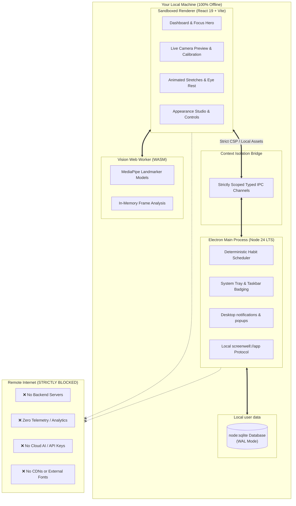

<div align="center">


# ScreenWell

### **Rest your eyes. Reset your posture. Reclaim your focus.**

*An offline desktop companion for study sessions, screen breaks, hydration, and posture awareness.*

*Created for the **Applied Design Thinking Lab (CS238DL)** · Supporting **UN SDG 3: Good Health and Well-Being**.*

[](https://github.com/Tech-Adii/ScreenWell/releases/tag/v1.14.0)
[](#-quick-start--installation)
[](#-radical-privacy--offline-first-architecture)
[](LICENSE)
[](VALIDATION.md)
[](#-smart-on-device-vision-engine)

[Windows download](https://github.com/Tech-Adii/ScreenWell/releases/tag/v1.14.0) • [Linux download](https://github.com/Tech-Adii/ScreenWell/releases/tag/v1.14.0-linux) • [Mac download](https://github.com/Tech-Adii/ScreenWell/releases/tag/v1.14.0-mac) • [Key features](#-core-capabilities) • [Architecture](#-radical-privacy--offline-first-architecture) • [Quick start](#-quick-start--installation)

</div>

---

## 🌟 Executive Summary

ScreenWell helps students and other desktop users plan work around eye rests, movement, and water breaks. Choose a study profile or set your own timings. The camera is optional and can provide on-device estimates of blinks, posture, and relative screen distance.

Reminders can be snoozed, skipped, or paused. Your study history stays on your device, and **Mentor Demo Mode** uses separate sample data for classroom presentations. The camera readings support habit awareness. Their accuracy depends on the camera, lighting, and calibration. [Wellness guidance and scope](WELLNESS-GUIDANCE.md)

---

## 📊 Human-Centered Design Traceability ($N = 91$)

ScreenWell was developed following the rigorous **Design Thinking Framework** (Empathize $\rightarrow$ Define $\rightarrow$ Ideate $\rightarrow$ Prototype $\rightarrow$ Test) in the **Applied Design Thinking Lab (CS238DL)**. Its features stem directly from empirical survey findings from **91 student and knowledge-worker respondents**:

| Survey Finding ($N = 91$) | Human-Centered Design Response | Technical Implementation |
| :--- | :--- | :--- |
| **52.7%** use laptops/PCs **4+ hours/day** | Sustainable, personalized pacing | Main-process deterministic scheduler with customizable work/rest cycles |
| **60.4%** report **tired or dry eyes** | Active blink awareness & eye rest | Local MediaPipe EAR tracking (12 blinks/min heuristic) + animated 20-20-20 guides |
| **47.0%** experience **neck & shoulder strain** | Real-time posture & ergonomics cues | 3D skeletal neck/shoulder angle tracking with sustained hold detection (score < 80) |
| **70.3%** skip breaks due to focus & deadlines | Non-disruptive, graceful deferral | **Important Task Mode** (exam shield), smart snooze (5/10/15m), and typing pauses |
| **73.6%** demand **snooze & pause controls** | Absolute user autonomy (no locked screens) | Topmost `showInactive()` popups with snooze, skip, and off-for-today actions |
| **39.6%** prefer non-modal desktop popups | Subtitle-style desktop notifications | Independent floating desktop reminder card alongside native WinRT toast alerts |
| **45.1%** want **hydration tracking** | Frictionless habit reinforcement | Animated water glass logger, customizable daily goal, active hours, and streaks |
| **38.5%** seek **guided desk stretches** | Actionable physical resets | Illustrated movement guides with seated options |
| **39.6%** express **privacy reluctance with webcams** | Privacy-first architecture | **100% Offline**: camera off by default; explicit session consent; RAM-only processing |
| **30.8%** request **progress summaries** | Guilt-free reflection & reporting | Local habit score formula, daily/weekly charts, and deterministic PDF/CSV exports |

---

## ✨ Core Capabilities

### 👁️ Smart On-Device Vision Engine
ScreenWell runs bundled **MediaPipe Tasks Vision** models in a local Web Worker.
* **Blink rate monitoring** estimates blinks from changes in Eye Aspect Ratio. Smoothing and tracking-gap checks reduce false counts.
* **Posture awareness** uses estimated shoulder slope, neck position, and head tilt. Choose **Lite**, **Full**, or **Heavy** pose tracking at a model-dependent 5–8 FPS.
* **Relative Proximity Warnings**: Detects prolonged forward-head slouching (triggers after 10 continuous seconds at 125% calibrated face-scale) with a 60-second recovery cooldown.
* **Transparent Signal Confidence**: Computes an honest real-time confidence rating derived from lighting conditions, head angle, and landmark visibility. If the user steps away or lighting degrades, it gracefully displays status without guessing.

```text
       [Webcam Frame]
             │
             ▼ (Volatile in-memory transfer)
   [Vision Web Worker] ──► MediaPipe Face & Pose WASM (5-8 FPS)
             │
             ├──► Eye Aspect Ratio (EAR) ──► Blink Rate Analysis
             ├──► 3D Skeletal Angles     ──► Posture Score (Threshold: 80)
             └──► Face Scale Ratio       ──► Proximity / Distance Warning
             │
             ▼
   [Immediate Memory Drop] (Zero frames saved, Zero network requests)
```

### ⏱️ Guided Study Sessions & Deep Focus Planner
* **Study profiles** include **Quick Review**, **Balanced Study** with 20-minute blocks and 30-second eye rests, and **Practice Exam** with longer blocks. Save up to eight custom profiles.
* **Background countdown** shows remaining time in the Linux window title. Windows adds a taskbar badge and progress bar. Minimize ScreenWell to keep the session and selected camera checks running.
* **Automatic Absence & Step-Away Logging**: If camera monitoring is active and you leave your desk, ScreenWell tracks the sustained absence and prompts you upon return: *"Count as break"* or *"Dismiss"*.
* **Important Task mode** pauses scheduled wellness reminders during a dedicated focus period.

### 🧘 Interactive Guided Exercises & Voice Coaching
* **6-Step Animated Eye Rest**: Guides you through distance gaze, soft blinking, closed-eye resting, gentle palming, near/far focus shifts, and figure-eight tracking.
* **Illustrated stretches** guide gentle movement for the neck, shoulders, arms, wrists, and more.
* **Offline voice guidance** uses an available local English system voice. Linux uses Speech Dispatcher. Written instructions remain available on all platforms.

### 💧 Hydration Companion & Daily Productivity
* **Hydration Tracker**: Set custom daily fluid goals and active hours. Log glasses with a single click and maintain healthy hydration streaks.
* **Daily Top 5 Priorities**: Organize today’s most critical objectives and set an explicit daily focus goal that persists across app restarts.
* **1–2 Minute Breathing Reset**: Take an on-demand mental reset with an animated expanding/contracting breathing circle, complete with reduced-motion support.
* **Command palette** opens with `Ctrl + K` on Windows and Linux or `Command + K` on macOS. Search for pages and quick actions.

### 🎨 Appearance Studio & Universal Accessibility
* **Nine palettes** include Cobalt, Aurora, Lagoon, and Forest. Choose light, dark, or system mode and customize the primary and companion colors.
* **Motion settings** include **Still**, **Gentle**, and **Expressive**. The app follows the system's reduced-motion preference.
* **Accessibility controls** include larger text, high contrast, keyboard navigation, and screen-reader labels.

### 📊 Local Analytics, Export & Mentor Demo
* **Habit score** uses weights of 40 for completed breaks, 30 for hydration, 20 for observed posture, and 10 for observed blinks. When camera readings are absent, the app rescales the available weights.
* **Local PDF and CSV reports** show your progress and activity history. CSV export handles text that could otherwise be interpreted as a spreadsheet formula.
* **Mentor Demo Mode**: Switch to an isolated, in-memory synthetic dataset with pre-seeded study sessions, hydration logs, and posture check-ins for classroom presentations and evaluations without touching personal records.

---

## 🔒 Radical Privacy & Offline-First Architecture

ScreenWell was designed with a zero-trust model toward third-party surveillance:



### Security & Privacy Guarantees
1. **Zero External Network Connections**: Content Security Policy (CSP) forbids external scripts, styles, fonts, and network endpoints. The application is served strictly via the local `screenwell://app` protocol.
2. **Volatile Frame Processing**: Camera video feeds are transferred directly to worker memory, processed for landmark coordinates, and immediately dereferenced. **No frames, images, or audio are ever written to disk or transmitted.**
3. **Opt-In Camera Permissions**: The camera is strictly **OFF** on initial startup and every subsequent launch. Camera use is decoupled from study sessions and can be revoked at any moment with a single click.
4. **Built-in SQLite storage** keeps study history and preferences in the current user's app data folder. Open **Privacy & purpose → Where your data lives** to find the exact path.

---

## 📂 Repository Layout

```text
ScreenWell/
├── main/               # Electron lifecycle, window management, system tray, notifications, IPC
├── renderer/           # React 19 UI, Lucide icons, Recharts, exercise animations, Appearance Studio
├── engine/             # Pure deterministic scheduler for breaks, hydration, stretches, and quiet hours
├── vision/             # Pure MediaPipe vision workers, EAR calculations, 3D posture heuristics
├── data/               # Native node:sqlite migrations, summary aggregators, PDF-Lib generators
├── shared/             # Type-safe IPC contracts, default configurations, and Zod schemas
├── assets/             # Bundled MediaPipe models, WASM binaries, Nunito Sans fonts, app icons, chimes
├── scripts/            # Asset prepackagers, licenses auditor, offline verification, and setup builders
├── tests/              # Vitest unit test suite (118 tests) & Playwright desktop UI scenarios (22 tests)
├── release/            # Generated packages and verification records after a local build
├── DECISIONS.md        # Engineering decisions and rationale
├── PRIVACY.md          # Comprehensive data storage and memory lifecycle disclosures
├── TRACEABILITY.md     # Full mapping of N=91 survey findings to implemented code
├── VALIDATION.md       # Empirical testing records, test coverage, and release checks
└── WELLNESS-GUIDANCE.md# Medical disclaimer, Mayo Clinic stretch sources, and AAO references
```

---

## 🚀 Quick Start & Installation

### Windows x64
1. Download and open `ScreenWell-1.14.0-Setup.exe`. [Download Windows Setup](https://github.com/Tech-Adii/ScreenWell/releases/download/v1.14.0/ScreenWell-1.14.0-Setup.exe)
2. Run the installer. It installs locally for your Windows user profile without requiring administrator privileges.
3. Launch ScreenWell from your desktop shortcut or Start menu. If upgrading, quit the older copy from its tray menu before starting Setup.

The setup is unsigned. Windows Smart App Control can block it on protected PCs. [Package checksum](https://github.com/Tech-Adii/ScreenWell/releases/download/v1.14.0/SHA256SUMS.txt)

### Linux x64 preview

Pick the `.deb` for Ubuntu or Debian, or the AppImage for another compatible desktop. The Linux preview targets 64-bit Intel and AMD processors and was tested on Ubuntu 24.04. [Linux release](https://github.com/Tech-Adii/ScreenWell/releases/tag/v1.14.0-linux)

- **Ubuntu or Debian**. Download the `.deb`, open it in your desktop's software installer, and click **Install**. Open **ScreenWell** from the applications menu. [Download the .deb](https://github.com/Tech-Adii/ScreenWell/releases/download/v1.14.0-linux/ScreenWell-1.14.0-linux-amd64.deb)
- **AppImage**. In the file's properties, allow it to run as a program, then open it. [Linux install guide](LINUX-README.md)

Minimize ScreenWell to keep tracking and reminders running. On Linux, closing the window quits the app and saves your active study session for later. Tray and popup behavior varies by desktop.

### macOS preview (Apple Silicon and Intel)

Open **Apple menu → About This Mac** to check your chip. Download and open the matching `.pkg`, then follow the Installer prompts. ScreenWell appears in **Applications**. [Apple Silicon installer](https://github.com/Tech-Adii/ScreenWell/releases/download/v1.14.0-mac/ScreenWell-1.14.0-mac-arm64.pkg) · [Intel installer](https://github.com/Tech-Adii/ScreenWell/releases/download/v1.14.0-mac/ScreenWell-1.14.0-mac-x64.pkg)

Apple has yet to notarize these previews. macOS security settings may block them on some Macs, including managed devices. [Mac guide](MAC-README.md)
---

## 🛠️ Developer Guide & Toolchain

### Prerequisites
* **Build host**: Use Windows for the Windows setup, Linux for the Linux packages, or a Mac for macOS packaging.
* **Runtime**: [Node.js 24 LTS](https://nodejs.org/) or newer with `npm`
* **Windows tools**: 7-Zip verifies the generated setup. The signed build also requires NSIS 3.12+, SignTool, and signing credentials.

### Initial Setup & Development
```bash
# Clone the repository
git clone https://github.com/Tech-Adii/ScreenWell.git
cd ScreenWell

# Install pinned dependencies
npm ci

# Download and verify offline MediaPipe models, WASM runtimes, and local assets
npm run assets

# Build and launch the app
npm run dev
```

### Verification & Testing Suite
ScreenWell enforces strict static analysis, unit testing, and desktop automation before any release:

```powershell
# Run the 118 unit tests (scheduler, vision geometry, SQLite storage, score formula)
npm test

# Run code style & static analysis
npm run lint

# Run Playwright desktop end-to-end scenarios (launches real Electron window)
npm run test:ui
```

### Production Packaging
```powershell
# Build standard NSIS Windows setup installer + verify with 7-Zip
npm run dist:setup

# Build portable single-file executable
npm run dist:portable

# Build both Windows targets
npm run dist
```

On Linux, run `npm run dist:linux` to build the `.deb` and AppImage. On a Mac, run `npm run dist:mac:preview` for local preview packages.

To create a signed release with an official Authenticode certificate:
```powershell
$env:SCREENWELL_SIGN_CERT_SHA1 = "<Certificate-Thumbprint>"
$env:SCREENWELL_SIGNTOOL = "C:\Program Files (x86)\Windows Kits\10\bin\10.0.22621.0\x64\signtool.exe"
$env:SCREENWELL_MAKENSIS = "C:\Program Files (x86)\NSIS\makensis.exe"
npm run dist:setup:signed
```

---

## 🔬 Validation & Reliability Record

- **Windows 11 x64** passed 118 unit tests, 22 desktop scenarios, and installer checks for offline launch, upgrade, and uninstall.
- **Ubuntu 24.04 x64** passed 118 unit tests. The installed Debian package and extracted AppImage passed offline desktop checks. The Debian package also passed a minimized-camera test with synthetic video. [Linux workflow results](https://github.com/Tech-Adii/ScreenWell/actions/runs/45415738046)
- **macOS 15** passed 118 unit tests on both Apple Silicon and Intel. Each app launched from its own disk image and ran a study session offline with the camera off. [macOS verification](https://github.com/Tech-Adii/ScreenWell/actions/runs/45425551930)
- **Test limits** include physical webcam accuracy, spoken audio on Mac, and differences between Linux desktops. [Validation record](VALIDATION.md)

---

## 📚 Project Documentation Hub

Explore the complete engineering and research documentation:
* 📑 **[DECISIONS.md](DECISIONS.md)**: Engineering decisions behind the technology, local database, vision heuristics, and reminders.
* 🛡️ **[PRIVACY.md](PRIVACY.md)**: Exhaustive data dictionary, local storage lifecycle, and memory management disclosures.
* 📈 **[TRACEABILITY.md](TRACEABILITY.md)**: Comprehensive mapping between the $N = 91$ student survey findings and concrete feature implementations.
* 🩺 **[WELLNESS-GUIDANCE.md](WELLNESS-GUIDANCE.md)**: Clinical scope, American Academy of Ophthalmology (AAO) computer vision references, and Mayo Clinic desk stretch guidelines.
* 🎭 **[DEMO_SCRIPT.md](DEMO_SCRIPT.md)**: Complete step-by-step walkthrough script for mentors, reviewers, and evaluators.
* **[LINUX-README.md](LINUX-README.md)** and **[MAC-README.md](MAC-README.md)** cover platform-specific setup and packaging.
* 📜 **[CHANGELOG.md](CHANGELOG.md)**: Complete release history detailing features from v1.0.0 through v1.14.0.

---

## 🎓 Academic Alignment & SDG 3

ScreenWell was developed as an academic project within the **Applied Design Thinking Lab (CS238DL)**, directly addressing **United Nations Sustainable Development Goal 3**:
> **UN SDG 3: Good Health and Well-Being** — *Ensure healthy lives and promote well-being for all at all ages.*  
> Specifically targeting **Target 3.4**: Promoting mental health, well-being, and preventive physical health habits in high-stress digital study environments.

---

## 📄 License & Attribution

ScreenWell is open-source software licensed under the **[MIT License](LICENSE)**.

Developed with ❤️ by **[Tech-Adii](https://github.com/Tech-Adii)** and the ScreenWell team for CS238DL.  
*All third-party open-source components, models, and font licenses are documented in [THIRD_PARTY_NOTICES.md](THIRD_PARTY_NOTICES.md).*
